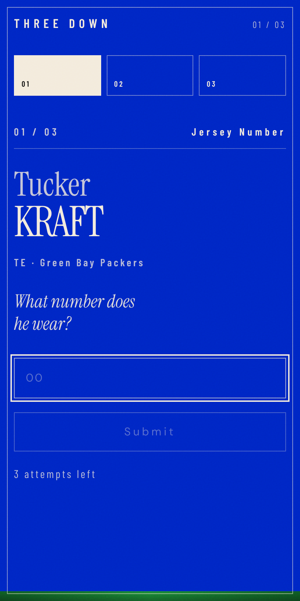

# THREE DOWN

**Three players. Three questions. No hints.**

A quick NFL trivia game for the browser. Each round puts three current players in front of you, and you name one fact about each: jersey number, draft year, or college.



## How to play

Each round has three questions, each about a different player:

1. **Jersey number:** what number does he wear for his current team?
2. **Draft year:** what year was he drafted?
3. **College:** where did he play college football? Start typing for suggestions. Common names and abbreviations count.

You get three tries per question. Your score is out of 3, and your record (games played, average, perfect games and best streak) stays in your browser. Hit **Share** to copy your result.

The player pool is 119 current NFL players at every position, with rosters as of the 2026 season.

## Run locally

Requires Node.js 20+.

```bash
npm install
npm run dev
```

Other scripts:

```bash
npm run build     # type-check and build to dist/
npm run preview   # serve the production build
npm run check     # validate answer matching against the player data
```

## Stack

React 19 · TypeScript · Vite · Tailwind CSS 4. No backend, accounts, or tracking.

## Project layout

```
src/
  data/        player pool and college aliases
  lib/         game generation, answer checking, local record
  hooks/       useGame: round state and flow
  components/  question, answer field, progress, results
```
